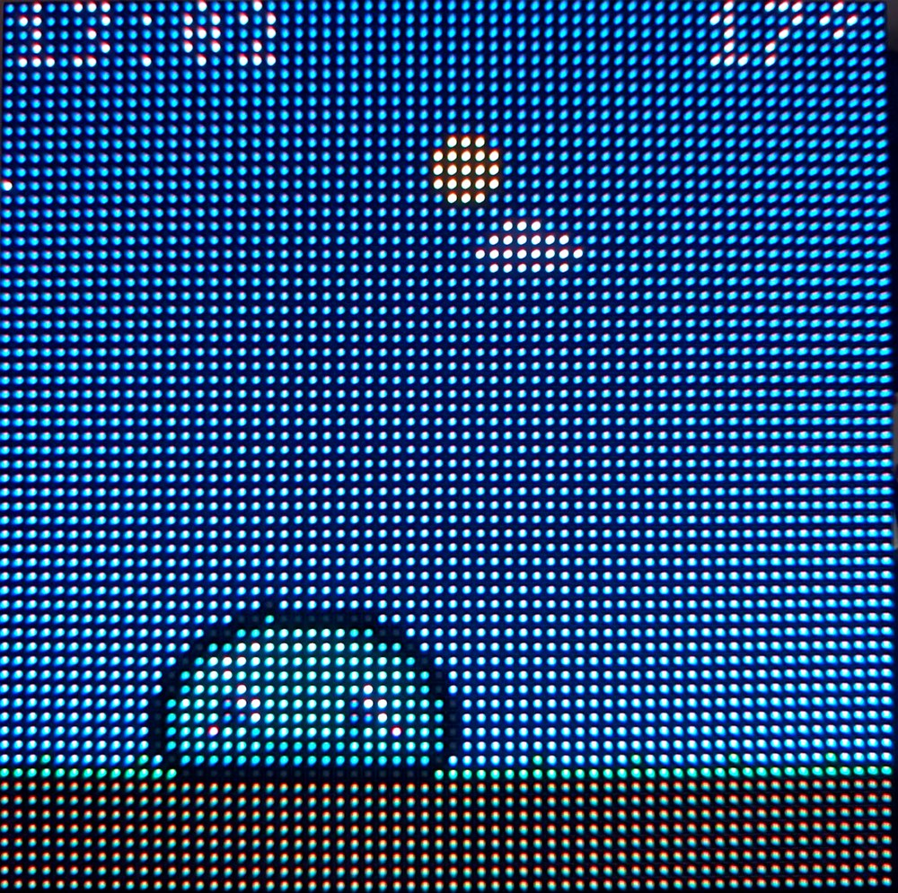
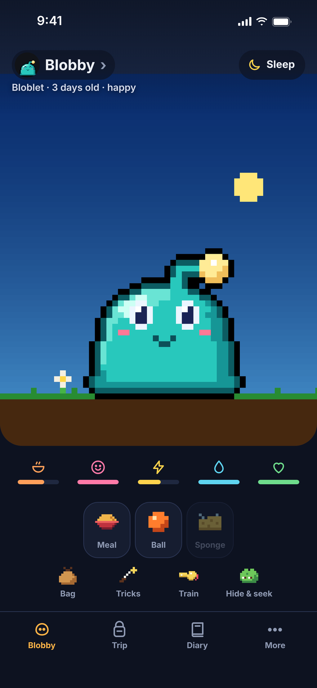
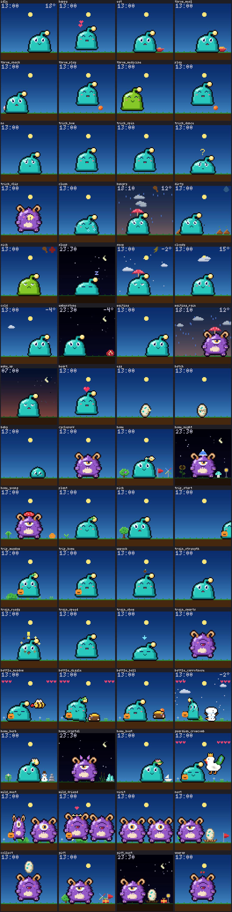

# Blobling

A small virtual pet lives on a 64×64 RGB LED panel driven by a Raspberry Pi.
You look after it from your phone: drag food, a ball or the sponge onto the
pet, and it happens on the panel. It wants your attention a few times
a day and also tells you the time and the weather.

<p align="center">
  
  
</p>

- **It lives with you.** The sky follows the real time of day, with sunrise
  and sunset for your location; clouds, rain and snow come from the real
  weather. On a cold morning the pet wakes up shivering, until you rub it warm.
  Left to itself, it plays and practices on its own, it waits at the edge of
  the panel around the times it is usually fed, and when you come back the app
  tells you what it has been up to. The panel also shows the time and
  the temperature.
- **The phone is your hand.** Drag food, snacks, a ball or medicine onto the
  pet, stroke it with your finger, rub it clean with the sponge, and put it to
  bed at night.
- **It grows up.** It hatches from an egg and grows over ten days into one of
  five adult forms, depending on how you cared for it. It learns tricks, trains,
  goes on trips, scuffles with whoever gets in its way there and brings things
  home. Five areas open up one after the other, each one past a guardian, and
  one of the guardians keeps a rare egg that something else hatches from.
- **It makes friends.** A grown-up pet can impress a wild pet with its tricks.
  The friend comes to visit, brings a gift now and then, and in time the two
  lay an egg that passes a part of your pet's training on to the next one.
- **It is forgiving.** The pet never dies. Neglect makes it hungry, sad or
  sick, and that can always be fixed.
- **Quiet at night.** The panel dims or switches off in the hours you choose,
  and the pet sleeps.
- **English and German**, and further languages can be added with one file.



The rules of the game are in [docs/gameplay.md](docs/gameplay.md), and the
forms a pet can grow into are in [docs/pets.md](docs/pets.md), without
spoilers unless you ask for them.

> [!WARNING]
> **For your home network only.** The app has no login: everyone on your
> Wi-Fi can use it. Never make the Pi reachable from the internet, so no port
> forwarding in the router and no tunnels. See [Security](#security).

## What you need

- A Raspberry Pi 3 or 4 with a microSD card
- A 64×64 RGB LED panel (HUB75)
- An Adafruit RGB Matrix HAT or Bonnet
- A 5 V / 4 A power supply
- A soldering iron

The [hardware guide](docs/hardware.md) has the exact parts, the power supply
and the assembly, step by step.

## Quickstart

With the hardware assembled, this takes about half an hour, most of it
waiting.

### 1. Write the SD card

Start the [Raspberry Pi Imager](https://www.raspberrypi.com/software/) and
choose:

- **Device:** your Pi model
- **Operating system:** *Raspberry Pi OS (other)* → **Raspberry Pi OS Lite
  (64-bit)**
- **Storage:** the SD card

When asked about customisation, edit the settings:

- **Hostname:** for example `raspberrypi`
- **Username and password:** for example `pi` and a password (needed for
  `sudo` later)
- **Wi-Fi:** your network, its password and your country (not needed with a
  network cable)
- **Locale:** your time zone. Bedtime and night mode go by it.
- **SSH:** enable it, with the password or with your public key

Write the card, put it into the Pi, switch it on and wait about two minutes.

The examples below use the user `pi` and the hostname `raspberrypi`. If you
chose other names, replace them everywhere.

### 2. Install

Connect from a terminal on your PC (PowerShell on Windows):

```bash
ssh pi@raspberrypi.local
```

Then, on the Pi:

```bash
curl -fsSL https://github.com/mLampir/blobling/releases/latest/download/install.sh | sudo bash
```

This downloads the newest release, checks it and runs its `setup.sh`. No git
and no build tools are needed, neither on the Pi nor on a PC. The first run
takes 15 to 30 minutes (system updates and building the matrix library). The
setup:

1. updates the system, switches off the onboard sound and reserves one CPU
   core for the panel (`isolcpus=3`). Before the first change it saves
   `config.txt` and `cmdline.txt` as `*.orig-led-matrix`.
2. installs [rpi-rgb-led-matrix](https://github.com/hzeller/rpi-rgb-led-matrix)
   in a pinned version, with its Python bindings, for the small script that
   drives the panel.
3. installs Node and the app (built in advance for the release) with the
   configuration and the systemd service `led-matrix`, which starts at
   boot.

It can be run as often as you like; steps that are already done are skipped.

### 3. Reboot

```bash
sudo reboot
```

The reboot is needed once, because the setup changed boot settings.

### 4. Open it

On a phone or PC in the same network:

- **The Blobling app** on the phone looks after the pet on the panel once it
  is connected to the Pi (see [The app](#the-app-on-your-phone)).
- **<http://raspberrypi.local/pet>** is the same pet page in the browser,
  without installing anything.
- **<http://raspberrypi.local/>** has the settings: pet or panel off,
  brightness, night mode, your location and the language.

Enter your location on the settings page, as latitude and longitude in
decimal degrees (for example from OpenStreetMap: right-click → *Show
address*). The weather and the sunrise and sunset come from it; without a
location everything works, only without weather. The language is taken from
the first phone that opens a page, and can be changed there too.

Some Android phones don't know `.local` names. Use the Pi's IP address
instead, for example `http://192.168.0.42/pet`; the setup prints it at the
end. It helps to tell the router to always give the Pi the same address.

## Configuration

Brightness, night mode, whether the panel is on, the location and the
language are set in the web interface and survive a restart; they are kept in
`/var/lib/led-matrix/`.

`/etc/led-matrix/config.ini` is only for the hardware and the network, and
everything in it is optional: without the file, or with every line commented
out (as in the template [config.example.ini](config.example.ini)), the
defaults below apply.

| Section | Setting | Default | Meaning |
|---|---|---|---|
| `[matrix]` | `hardware_mapping` | `adafruit-hat` | `adafruit-hat-pwm` with the [PWM mod](docs/hardware.md#optional-the-pwm-mod-for-a-calmer-picture) |
| `[matrix]` | `gpio_slowdown` | `2` | `2` for a Pi 3; raise it if the picture flickers |
| `[matrix]` | `rows`, `cols` | `64` | Size of the panel in pixels |
| `[weather]` | `refresh_minutes` | `15` | How often the weather is fetched (at least 5) |
| `[web]` | `port` | `80` | Port of the web interface |

Files from older versions may still hold `[interface] language`,
`[location] latitude`/`longitude` and `[matrix] brightness`. They keep
working as starting values until something is chosen in the web interface,
which then wins.

After a change:

```bash
sudo systemctl restart led-matrix
```

A `config.ini` in the repo folder on the Pi takes precedence: the setup
installs it over the one in `/etc/led-matrix/` (the previous file is kept as
`config.ini.bak`). That file is in `.gitignore` and never ends up in Git.

## The app on your phone

The Blobling app for Android and iPhone is the pet page as a real app, from
Google Play and the App Store (the links follow once the apps are out). On
its own it keeps a pet on the phone; connected to a Pi, it looks after the
pet on the panel instead. To connect it, enter the Pi's address
(`raspberrypi.local`, or its IP address) in the app under *More*. The app
talks to the Pi over plain HTTP on the home network, so nothing has to be
installed on the Pi or the phone for it.

Without the app, <http://raspberrypi.local/pet> does the same in any browser
on the network.

## Security

The app is made for a home network and has **no login**. Everyone who is on
your network can feed the pet and change the settings.

- **Never open a port for the Pi in the router**, and don't put it behind a
  tunnel or a public address.
- As a second line of defence, the app only answers requests from private
  address ranges and from the networks the Pi itself is in (this matters with
  IPv6, where the Pi has a public address). Everything else gets a `403`.
- Other websites can't control the panel through your browser: every change
  needs a header that foreign pages aren't allowed to send.
- The Pi only makes outgoing requests: for the weather, to Open-Meteo (your
  location is sent there as coordinates), and to GitHub, to look for a new
  release.

## Running it

```bash
systemctl status led-matrix          # is the service running?
journalctl -u led-matrix -f          # follow the log
sudo systemctl restart led-matrix    # after changing config.ini
```

**Update:** when a newer release is out, the settings page says so and has
an *Update now* button. The Pi looks for one a minute after it starts and
then every six hours; it only asks GitHub, nothing is opened towards the
internet. The button takes about a minute, the panel goes dark briefly, and
the page reloads in the new version. The same from the command line:

```bash
curl -fsSL https://github.com/mLampir/blobling/releases/latest/download/install.sh | sudo bash -s -- --app
```

`--app` only updates the app, the configuration and the service; it takes
about a minute and needs no reboot. Without it, the system is updated as
well. The pet's save file and your settings are kept either way. The releases
are kept in `/opt/led-matrix/releases/`, the current one and the one before;
to go back, run `sudo bash /opt/led-matrix/releases/<version>/setup.sh --app`.

With the repo itself on the Pi (`git clone`), `git pull && sudo bash setup.sh
--app` in its folder does the same from the sources; the setup then builds
the app on the Pi.

**Backup** of the pet: *Save file* on the settings page downloads it and
loads one in its place. From the PC it also works with

```bash
scp pi@raspberrypi.local:/var/lib/led-matrix/pet.json .
```

Where things are on the Pi:

| Path | Content |
|---|---|
| `/opt/led-matrix/` | The app, the Python environment of the panel driver and the matrix library; `VERSION` is the installed release |
| `/opt/led-matrix/releases/` | The installed release and the one before |
| `/etc/led-matrix/config.ini` | Configuration |
| `/var/lib/led-matrix/pet.json` | The pet's save file |
| `/var/lib/led-matrix/pet.before-load.json` | The pet a loaded save file replaced (settings page) |
| `/var/lib/led-matrix/state.json` | Panel on or off, brightness, night mode |
| `/var/lib/led-matrix/settings.json` | Location and language from the settings page |

## Troubleshooting

Problems with the picture itself (dark panel, garbled halves, flicker) are in
the [hardware guide](docs/hardware.md#if-something-looks-wrong).

| Problem | What to do |
|---|---|
| The setup says the service is not running | `journalctl -u led-matrix -e` shows why |
| The update button reports a failed update | `journalctl -u led-matrix-update -e` shows why; the previous release is still in `/opt/led-matrix/releases/` |
| The log says `snd_bcm2835: found that the Pi sound module is loaded` | Reboot (`sudo reboot`); the setup has switched the sound off |
| No temperature in the top right corner, never any rain | Check the location on the settings page; look for `Weather request failed` in the log |
| The pet sleeps at the wrong time | The Pi's time zone is wrong: `timedatectl`, then `sudo timedatectl set-timezone Europe/Berlin` (with your zone) |
| `raspberrypi.local` can't be reached | Use the IP address (printed at the end of the setup, or listed in the router) |
| SSH reports `REMOTE HOST IDENTIFICATION HAS CHANGED` after rewriting the card | `ssh-keygen -R raspberrypi.local` on the PC |

## Development

The app is written in TypeScript. To work on it you need, on your PC:

- [Node.js](https://nodejs.org/) 20 or newer; it brings `npm` along.
- The repo, and in its folder, once and again whenever `package-lock.json`
  has changed, the build tools:

  ```bash
  npm ci
  ```

  They are TypeScript and esbuild, in pinned versions, and Capacitor for the
  apps from the stores. The server on the Pi uses no packages; the app only
  Capacitor's own (keeping the pet in a file, the phone's own HTTP).
- For deploying: `ssh` and `tar` (Windows 10 and newer, macOS and Linux have
  both) and SSH access to the Pi.
- Optional: Python 3, to see the app start with the panel driver, and with
  Pillow (`pip install -r requirements.txt`) to rebuild the sprite sheets.

All commands below are run in the repo folder.

### Run it on the PC

Without the matrix library the app starts with a dummy matrix; the preview in
the web interface (<http://localhost:8080/>) shows what the panel would show.

```bash
LED_MATRIX_CONFIG=./config.ini LED_MATRIX_DATA=./devdata LED_MATRIX_PORT=8080 \
LED_MATRIX_BDF_DIR=<path-to>/rpi-rgb-led-matrix/fonts \
LED_MATRIX_PYTHON=python npm start
```

`LED_MATRIX_PYTHON` is the Python that runs the panel driver; without one the
app starts all the same. `LED_MATRIX_BDF_DIR` is the `fonts` folder of
[rpi-rgb-led-matrix](https://github.com/hzeller/rpi-rgb-led-matrix) (on the
Pi: `/opt/led-matrix/rpi-rgb-led-matrix/fonts`); without it the scene has no
clock and no temperature. In PowerShell, set the variables with
`$env:LED_MATRIX_PORT = "8080"` and so on before `npm start`.

### Tests and preview

Tests, and a preview of the pet scene as a PNG or GIF:

```bash
npm test         # the tests
npm run check    # type check
npm run build    # the server for the Pi (dist/pi/server.mjs), the app (dist/app/), and the core alone
export LED_MATRIX_BDF_DIR=<path-to>/rpi-rgb-led-matrix/fonts
npm run preview -- --spoiler-free   # → pet_preview.png
npm run preview -- play --gif       # → pet_play.gif
```

### The app

The pet page is also the app for the phone (`app/pet.html`, its script in
`app/src/`). The page keeps its pet in one of two places: on the phone, where
the game runs in the page, the scene is drawn above the needs and the pet is
kept in the app's storage, or on a Pi, which shows it on the panel. The Pi
serves the page at `/pet` and is its pet there; the app from the stores keeps
its own pet, saved where the phone's backup takes it along, and can be
connected to a Pi under *More*.

To try the pet on the phone in the browser of this computer:

```bash
npm run app      # → http://localhost:8080
```

The apps for the stores are built with [Capacitor](https://capacitorjs.com/)
from `dist/app/`; their projects are `app/android/` and `app/ios/`
(`capacitor.config.json` says where). That needs Node.js 22 or newer, Android
Studio for Android and Xcode on a Mac for iOS:

```bash
npm run app:android   # build, copy into the projects, open Android Studio
npm run app:ios       # the same for Xcode
npm run app:icons     # the app icons and splash screens, drawn from the sprites
```

In Android Studio or Xcode the app is then started on a phone or packed for
the store as usual. Connected to a Pi, the app talks to it over plain HTTP on
the home network, through the phone's own network stack (`CapacitorHttp`), so
nothing needs to be installed for it on the Pi or the phone.

Without a computer, a test APK for Android comes from GitHub: under *Actions*,
*Android test build* → *Run workflow* with the branch to build; the APK lies
in the finished run as an artifact for a week. It is a debug build to install
by hand, not one for the store. Like every debug build, also one from
Android Studio, it installs as its own app, *Blobling Test*
(`at.lampir.blobling.test`), next to the app from the store.

The privacy policy the stores link to is [docs/privacy.md](docs/privacy.md)
(German: [docs/privacy.de.md](docs/privacy.de.md)), served by GitHub Pages
from this repo at <https://mlampir.github.io/blobling/privacy>; the
support page the stores link to is [docs/support.md](docs/support.md) (German:
[docs/support.de.md](docs/support.de.md))
(<https://mlampir.github.io/blobling/support>). A change
to what the app stores or sends goes into both.

### Deploy to the Pi

To bring a change to the Pi straight from the PC, without committing it:

```bash
npm run deploy                              # app and configuration only
npm run deploy -- --full                    # the complete setup, with system updates
npm run deploy -- --host pi@192.168.0.42    # another Pi, or by IP address
```

Without `--host` the Pi is taken from the environment variable
`LED_MATRIX_PI` (set it once, for example `setx LED_MATRIX_PI pi@raspberrypi.local`
on Windows or `export LED_MATRIX_PI=pi@raspberrypi.local` in your shell
profile), otherwise it is `pi@raspberrypi.local`.

The script builds the app on the PC, copies it and a local `config.ini` to
`~/led-matrix-pi` on the Pi and runs `setup.sh` there; `sudo` on the Pi asks
for the password. The Pi must have been set up once before (Quickstart). This
way it needs neither the sources nor npm.

### Releases

Publishing a release on GitHub starts the workflow
`.github/workflows/release.yml`: it runs the tests and the type check, builds
the package for the Pi and attaches it to the release as
`blobling-<tag>.tar.gz`, with its checksum next to it. The package holds
the same files that `npm run deploy` copies, plus a `VERSION` file with the
tag; unpacked on the Pi, `sudo bash setup.sh` installs it. `install.sh` is
attached as well, with the repository filled in, so the Quickstart's
`…/releases/latest/download/install.sh` always gives the newest one. Started
by hand under *Actions*, the workflow builds all of it without a release and
keeps it as a workflow artifact. The tag names the version, for example
`v1.2.0`.

The same tag builds the apps for the stores on [Codemagic](https://codemagic.io)
(`codemagic.yaml`): it runs the tests, builds and signs the apps and uploads
them, iOS to TestFlight and Android to the internal test track of Google Play.
From there a build is released to everyone by hand, in App Store Connect and
the Play Console. The tag's version becomes the app's version; the build
number is one more than the newest one in the store. Only tags start these
builds, never a push or a pull request, and the signing keys and store logins
are kept in Codemagic, not in the repo. Keep `codemagic.yaml` plain ASCII,
Codemagic does not read anything else.
Until the app exists in Google Play, only iOS builds on a tag; the Android
workflow is started by hand in Codemagic.

To build the package locally:

```bash
npm run package -- --version v1.2.0                  # → dist/blobling-v1.2.0.tar.gz and .sha256
npm run package -- --version v1.2.0 --repo me/fork   # also dist/install.sh for that repository
```

### Where things are

| Path | Purpose |
|---|---|
| `setup.sh` | Sets up the Pi completely (`--app`: update the app only) |
| `core/` | The pet: game logic, scene and sprites (`src/`) and their tests (`test/`). It runs anywhere and knows nothing about files or the panel; `api.ts` is the pet's JSON API, `weather.ts` asks Open-Meteo |
| `pi/src/main.ts` | Entry point on the Pi: panel driver, display loop, web server |
| `pi/src/display.ts` | The display loop (pet, off, brightness, night mode) |
| `pi/src/web.ts`, `pi/src/network.ts` | Web interface and API, and the check that a request comes from the home network |
| `pi/src/config.ts`, `pi/src/storage.ts` | `config.ini` and the paths; the pet's save file and the language files |
| `pi/src/settings.ts` | Language and location as the settings page sets them (`settings.json`), over `config.ini` |
| `pi/panel_driver.py` | All that talks to the panel: it shows the frames the app sends it through a pipe. `pi/panel-test.sh` is a hardware test for it |
| `pi/test/` | Tests of the Pi's side |
| `app/pet.html`, `app/src/` | The pet page and its script: the app, with the pet on the phone or on a Pi (tests in `app/test/`) |
| `app/android/`, `app/ios/`, `capacitor.config.json` | The app's projects for the stores (Capacitor); `tools/app_icons.ts` draws their icons |
| `app/templates/` | The web interface (settings page) |
| `app/locales/` | All texts of the interface, one file per language |
| `docs/privacy.md`, `docs/support.md` (each with a `.de.md`), `docs/_config.yml` | The app's privacy policy and support page for the stores, and the settings of the GitHub Pages site that serves them |
| `app/pet/assets/` | The sprite sheets |
| `systemd/` | The service, and the update unit the button starts |
| `pi/src/update.ts` | Looks for a newer release and starts the update unit (only on a Pi installed from a release) |
| `tools/deploy.mjs` | `npm run deploy`: builds the app on the PC, copies it to the Pi and runs the setup there |
| `tools/serve.mjs` | `npm run app`: the app in the browser of the PC |
| `install.sh` | Downloads a release on the Pi and runs its `setup.sh` (attached to every release) |
| `tools/package.mjs`, `tools/bundle.mjs` | `npm run package`: the release package; `bundle.mjs` lists the files that go to the Pi, for the package and for `npm run deploy` |
| `.github/workflows/release.yml` | Builds the package and attaches it and `install.sh` to each release |
| `codemagic.yaml` | Builds the apps for the stores on a release tag and uploads them for testing |
| `.github/workflows/android-test.yml` | Started by hand: a test APK of the app, to install on an Android phone (a debug build, kept for a week) |
| `.github/workflows/test.yml` | Tests and type check on every pull request and every push to `main` |
| `tools/` | Preview of the scene, and the pixel art as text → sprite sheets (the one Python tool, it needs `pip install -r requirements.txt`); build and test scripts |


## License and credits

Copyright (C) 2026 Lampir (<https://lampir.at>)

- **Code:** GNU General Public License, version 2 or (at your option) any
  later version, see [LICENSE](LICENSE). The project comes without any
  warranty.
- **Sprites** in `app/pet/assets/`:
  [CC BY-NC 4.0](https://creativecommons.org/licenses/by-nc/4.0/), see
  [app/pet/assets/LICENSE.txt](app/pet/assets/LICENSE.txt). Use, change and
  share them freely, just don't sell them. You don't need to give credit.
- The sprites and much of the code were created with
  [Claude](https://claude.com/).
- The panel is driven by
  [rpi-rgb-led-matrix](https://github.com/hzeller/rpi-rgb-led-matrix) by
  Henner Zeller (GPL v2 or later).
- Weather data by [Open-Meteo.com](https://open-meteo.com/) under
  [CC BY 4.0](https://creativecommons.org/licenses/by/4.0/); their free
  service is for non-commercial use.
