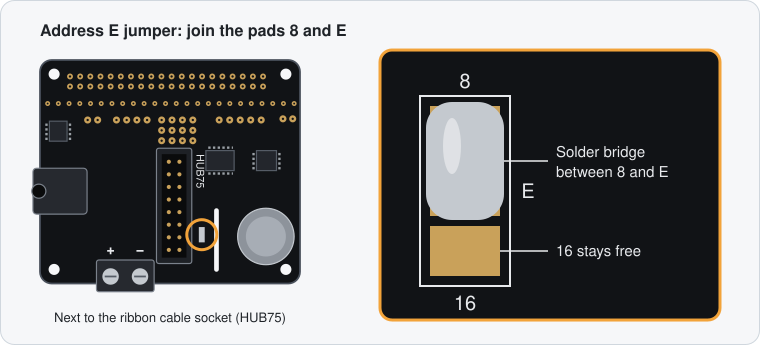
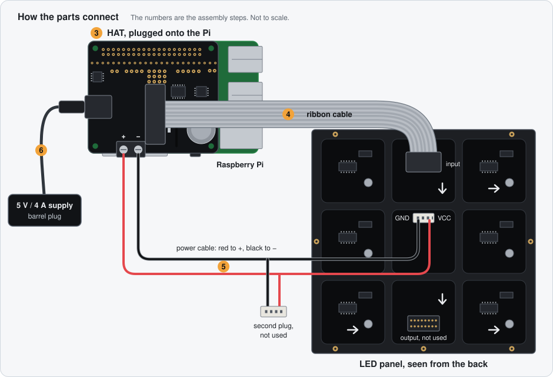
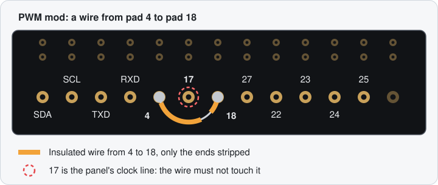

# Hardware

What you need to build the pet, and how the parts go together. The software
side starts in the [README](../README.md).

The build needs a soldering iron: the HAT comes as a kit, and a 64×64 panel
needs one solder bridge on it. None of it is difficult, and it is a good first
soldering project.

## Parts

| Part | What this project uses | What else works |
|---|---|---|
| Raspberry Pi | Pi 3 Model B+ | Pi 3 B, Pi 4, see [Which Pi](#which-pi) |
| microSD card | SanDisk, 32 GB | Any card of 8 GB or more |
| LED panel | [Adafruit 64×64 RGB LED Matrix, 3 mm pitch](https://www.adafruit.com/product/4732) (product 4732), 192 × 192 mm | Other 64×64 HUB75 panels, see [Other panels](#other-panels) |
| Matrix adapter | [Adafruit RGB Matrix HAT + RTC](https://www.adafruit.com/product/2345) (product 2345) | [Adafruit RGB Matrix Bonnet](https://www.adafruit.com/product/3211) (product 3211), comes assembled |
| Power supply | 5 V / 4 A with a 2.1 mm barrel plug, see [Power](#power) | |

The panel comes with the ribbon cable for the data and a power cable. The
links go to the manufacturer; the product numbers help to find the same parts
at a reseller in your country. As a rough guide, panel, HAT and power supply
together cost about 100 to 120 euros (2026), plus the Pi and the card.

You do not need:

- A battery for the clock on the HAT. The clock (a DS1307) is not used; the
  Pi gets the time from the network.

Tools: soldering iron and solder, a small screwdriver for the terminal block,
and a PC with a card reader for writing the SD card. For the optional
[PWM mod](#optional-the-pwm-mod-for-a-calmer-picture) also a short piece of
thin wire.

Nice to have: four M3 screws for mounting (the panel has threaded holes on the
back, but no screws are included) and a frame or stand. A sheet of frosted
acrylic or thin paper in front of the panel softens the pixels.

## Which Pi

The setup reserves the fourth CPU core for refreshing the panel
(`isolcpus=3`), so the Pi needs four cores.

| Model | Status |
|---|---|
| Pi 3 B / B+ | Tested (B+). `gpio_slowdown = 2` |
| Pi 4 | Supported by the matrix library, not tested here. May need `gpio_slowdown = 3` or `4` |
| Pi Zero 2 W | Four cores, so it should work. Not tested, and the header has to be soldered on |
| Pi Zero, Zero W, Pi 1 | No. One core only, and too slow for the library |
| Pi 5 | No. The matrix library does not officially support it |

`gpio_slowdown` is set in `/etc/led-matrix/config.ini` under `[matrix]`.

## Power

The panel is the hungry part. Adafruit's rule of thumb for the worst case
(every pixel white at full brightness) is 0.12 A per pixel of width, which
makes 7.7 A for a panel 64 pixels wide. The pet scene is mostly dark and runs
at reduced brightness, so it stays far below that. A phone charger or the
Pi's own power supply is still not enough: the panel flickers, shows wrong
colours, or the Pi restarts.

Use a 5 V / 4 A plug-in power supply with a 2.1 mm barrel plug (centre
positive), as Adafruit recommends for this panel, for example a Mean Well
GST25E05-P1J. It plugs into the HAT, and the HAT passes the power on to the
panel and, through the header, to the Pi. Never connect a 12 V supply: the
panel takes its power directly, without a regulator.

### If the Pi gets too little voltage

The HAT feeds the Pi through a diode that costs about 0.25 V, which can leave
the Pi just above the 4.63 V at which it reports undervoltage. You notice it
when the picture flickers in bursts and the red LED on the Pi goes out for a
moment. On the Pi, `vcgencmd get_throttled` then prints something other than
`throttled=0x0`. A supply with more amperes does not help, because the
diode costs the same 0.25 V. A supply with slightly more voltage (about
5.2 V, like the Pi's official one) can be enough; go no higher, since the
panel takes the voltage directly. The sure fix is to power the Pi through
its own micro-USB socket, which bypasses the diode. Either:

- **a second supply:** a 5 V micro-USB power supply for the Pi (2.5 A, like
  the official one). Nothing to cut or wire, so this is the safer choice
  without a multimeter; or
- **a cable from the HAT:** a micro-USB cable from the HAT's terminal block
  to the Pi, so the one supply still runs everything. The Pi takes well under
  1 A of the 4 A, which leaves the panel plenty.

To make the cable you need a micro-USB cable (short, with thick wires), a
multimeter, wire cutters and insulating tape.

> **Mind the polarity.** If plus and minus are swapped, the Pi is damaged.
> The colours inside USB cables are not always right, so measure first.

1. Unplug the power supply from the HAT.
2. Cut off the big USB-A plug 5 to 10 cm from the plug. Keep the short piece
   for measuring.
3. On the long piece, strip about 3 cm of the outer sheath. Red and black
   carry power. Cut the data wires (green and white) and any shield short and
   tape them up, so they cannot touch red, black or the terminal block.
4. Plug the short piece into a USB charger and measure its wires: red probe
   on red, black probe on black has to show about +5 V, without a minus sign.
   Both pieces come from the same cable, so the colours match. If not, the
   wire that reads +5 V against the other is plus.
5. Strip about 6 mm of red and black and twist the strands, or crimp on a
   wire ferrule.
6. Clamp red into `+` and black into `-` of the terminal block, next to the
   panel's power cable, and tighten firmly. Pull on each wire: it must hold,
   and no stray strand may reach the other terminal.
7. Plug the micro-USB end into the Pi, then the power supply into the HAT.
   The red LED has to stay on, and `vcgencmd get_throttled` has to print
   `throttled=0x0` after a restart.

## Assembly

Adafruit's guide shows each step with photos:
[RGB Matrix HAT + RTC for Raspberry Pi](https://learn.adafruit.com/adafruit-rgb-matrix-plus-real-time-clock-hat-for-raspberry-pi).
In short:

1. **Solder the three parts onto the HAT:** the 2×20 socket (underside, it
   plugs onto the Pi), the 2×8 socket for the ribbon cable (mind the notch,
   it matches the outline printed on the board) and the 2-pin terminal block.
   The Bonnet comes with all of this fitted.
2. **Close the address E jumper.** A 64×64 panel needs a fifth address line.
   On the HAT are three small pads in a row, marked `8`, `E` and `16`.
   Join the middle pad to the `8` pad with a blob of solder (for Adafruit
   panels; a few panels from other makers need `16` instead).
   Without this bridge only half of the picture is right.

   
3. **Plug the HAT onto the Pi.**
4. **Connect the data.** The ribbon cable goes from the HAT to the panel's
   *input* socket. The arrows printed on the back of the panel point away
   from the input.
5. **Connect the power.** Screw the spade lugs of the panel's power cable
   into the HAT's terminal block, red to `+` and black to `-`, and plug the
   other end into the panel. The cable has a second plug for a further
   panel; it stays unconnected.
6. Plug in the power supply only when everything else is connected.



The drawings on this page show the HAT. The Bonnet needs the same address E
jumper and takes the same PWM mod, and the pads carry the same labels, but
they sit in other places; the address E jumper is on the underside. Adafruit's
[Bonnet guide](https://learn.adafruit.com/adafruit-rgb-matrix-bonnet-for-raspberry-pi)
shows both with photos.

## Optional: the PWM mod for a calmer picture

Out of the box the HAT times the panel in software, which shows as a faint
flicker, mostly in dark colours and at low brightness. One wire fixes that by
letting the Pi's hardware timer do the job: solder a short wire between
**GPIO4** and **GPIO18** on the HAT. Both are labelled on the board.



Once the wire is in, tell the app in `/etc/led-matrix/config.ini`:

```ini
[matrix]
hardware_mapping = adafruit-hat-pwm
```

and restart the service (`sudo systemctl restart led-matrix`). The default,
`adafruit-hat`, works with or without the mod, only without the calmer
picture. With `adafruit-hat-pwm` but no wire, the panel shows no proper
picture.

The build this guide is based on has the mod and runs with
`adafruit-hat-pwm`.

In both cases the Pi's own sound output (HDMI and headphone jack) is switched
off by the setup, because the matrix library needs the same hardware.

## Other panels

Any 64×64 panel with a HUB75 connector should work. They are sold with
different pixel pitches (2 mm, 2.5 mm, 3 mm, …), which only changes the size.
Things that can differ:

- The address E jumper may need the `16` pad instead of `8` (see the panel's
  data sheet).
- Some panels use driver chips that need extra options of the matrix
  library, which the configuration does not offer yet.

The pet is drawn for exactly 64×64 pixels. Other resolutions are not
supported.

## If something looks wrong

| What you see | Likely cause |
|---|---|
| Panel stays dark | `hardware_mapping = adafruit-hat-pwm` without the PWM mod; power cable not connected; ribbon cable in the panel's output socket |
| Top and bottom half show the same or garbled picture | Address E jumper missing or on the wrong pad |
| Flicker, stripes, single wrong pixels | Raise `gpio_slowdown` to 3 or 4 |
| Picture flickers in bursts and the Pi's red LED goes out | The Pi gets too little voltage, see [If the Pi gets too little voltage](#if-the-pi-gets-too-little-voltage) |
| Colours fade or the Pi restarts when the picture gets bright | Power supply too weak |
